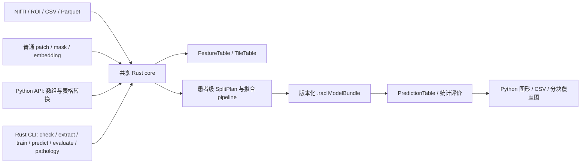

# 独立 Rust 影像组学与轻量病理分析引擎：架构、数值验证与性能技术报告

**文档状态：可审查草稿，待主 agent 整合最终验收结果。**

项目：[hurry060215-tech/radiomics](https://github.com/hurry060215-tech/radiomics)；Python 包/导入名保留 `ov-radiomics` / `ov_radiomics`，版本保留 `0.1.0`。

Radiomics 性能对象：不可变源码快照 `48ecb310a2d9ccb5da821733ee1190ce1764f27a`；核心实现摘要 `a39c66ee16dcf04aefd79f2b3996e1be5666b2903b0f40e991aaf5097d54c2a8`。后续接口变更与持续集成结果应单独标识，不能自动继承该快照的测量结论。

## 摘要

本项目实现一个可独立安装、通过 Rust CLI 或 Python API 使用的研究软件引擎，覆盖两条工作流：NIfTI/ROI/临床表到特征、患者分组建模、评价与外部预测；普通病理 patch 或外部 embedding 到质控、特征、切片/患者聚合与坐标覆盖图。主要工程贡献为共享 Rust 计算核心、显式数据契约、可移植模型容器，以及区分兼容性、标准定义和性能的可审计验证流程。

影像首批范围为 Original 的 **55 项明确列出的统计/纹理特征**，另含单独命名的 **11 项 `shape_basic` 体素支持域描述符**。PyRadiomics 兼容轨道固定公开 3.0.1；IBSI 轨道独立核对声明的配置与参考值。患者级 `SplitPlan` 将实际训练/验证患者集合传入嵌套筛选、有限参数搜索和 OOF 融合，模型以版本化 `.rad` JSON/类型化状态保存。

Radiomics Benchmark v2 在固定 Windows 机器上完成 **60 个 case、840 个双后端主观测及 14 个原生缓存观测**，全部执行与适用数值比较通过，无观测丢弃或 2 GiB 预算超限。性能结果随入口与工作量显著变化：真实公开 CT 的 prepared-array 路径为参考速度的 **0.400×**，即 Rust 慢 **2.50×**；CT 的 NIfTI→裁剪→完整导出路径为 **1.225×**，未达到 1.5× 目标。小型合成/phantom 流程中的较高加速比仅代表其固定场景。该结果支持统一原生内核和独立部署的工程价值，同时暴露数组边界转换与完整流程性能的优化需求。

机器学习/统计与病理性能套件在本稿中标为 **pending**，等待独立验收工作包交付，本文不为其填写未经核验的耗时、加速比或内存数字。本报告评价研究软件行为，不提供临床有效性、诊断性能或论文录用结论。

## 1. 动机与研究问题

影像组学研究通常需要衔接图像读取、空间几何、离散化、纹理矩阵、表格预处理、模型选择和统计评价。PyRadiomics 提供成熟的开放实现与公开计算路径；IBSI 强调特征定义、处理配置和标准化参考值。[1–3] 本项目的目标是将上述研究链路的核心计算汇入可独立运行的 Rust 引擎，并保留 Python 的表格接口与绘图便利性。

工程验证围绕三个问题展开：

1. 在明确支持的配置内，Rust 是否复现冻结 Python 行为，并保留几何、离散灰度、计数矩阵、退化输入和非有限状态的语义？
2. 共享患者划分、训练状态和模型容器能否使 CLI、Python、外部队列及不同预测层级保持可核验的一致性？
3. 算子、数组入口、端到端流程和批量调度分别具有怎样的速度、波动和内存表现，哪些性能目标尚未达到？

项目保持个人仓库和独立安装边界；ov 可通过普通 import 或显式数据适配使用本包。计算定义来自可重建的公开参考、公式和自建规格，不依据加密后端、工具名称或界面说明推断算法。

## 2. 系统架构与数据契约

### 2.1 一个核心、两类入口

仓库采用三个 crate：`ov-radiomics-core` 对应计算层 `radiomics-core`，`ov-radiomics-python` 提供 PyO3 绑定，`ov-radiomics-cli` 提供无 Python 的命令行工作流。Python 层负责数组/表格转换和绘图；原生模式不调用 PyRadiomics、sklearn 或 statsmodels。文件格式、线性代数、分布函数和序列化复用 Rust 库，避免重复实现通用基础设施。



对外数值对象使用连续缓冲区、维度、顺序与缺失标记，不暴露第三方矩阵类型。缺失数值使用有限存储值与显式 missing flag；未定义结果保持 missing/NaN/Inf 状态，不作为合法零值进入分析。

| 对象 | 关键内容 | 约束与用途 |
|---|---|---|
| `ImageSample` | sample/patient 元数据、标量图像、mask、完整 affine 与单位 | sample ID 唯一；patient ID 可重复；2D/3D 明确区分 |
| `FeatureTable` | 行主序数值、样本元数据、特征定义/顺序、有效参数和质量记录 | ID、结局和队列不进入特征矩阵；CSV/Parquet 保留 manifest |
| `TileTable` | patient→slide→tile、level-0 坐标、尺度、有效像素矩形、QC 和可选特征 | 坐标范围与实际 patch 像素尺寸分开；空切片仍保留患者父层级 |
| `SplitPlan` | 队列、类别映射、中心、内外折实际患者集合、种子和方法版本 | 验证真实集合；相同 fold 数字不代表相同训练来源 |
| `ModelBundle` | 拟合的填补/编码/缩放/筛选/模型、类别/特征顺序、阈值和配置 | schema1 `.rad` 类型化 JSON 容器；未知 schema、缺列或不收敛状态报错 |
| `PredictionTable` | 样本/患者/切片/tile ID、预测单位、概率/回归值、队列/折/训练来源 | 概率与类别顺序一致；层级/队列身份验证；禁止患者分数冒充 tile 分数 |

### 2.2 图像几何与独立运行边界

NIfTI 输入保留世界坐标、sform/qform 诊断、spacing、方向、原点和单位。图像/mask 对齐检查包含体素外角点；裁剪更新 affine。毫米参数与体素参数分开，未知单位不推测毫米值。首版正交距离运算拒绝 shear，要求显式重采样。图像重采样支持线性/最近邻，mask 仅最近邻；通用目标网格定义与 PyRadiomics 的 ROI 网格定义分别冻结。

影像批处理由最外层控制 `n_jobs`，输出确定排序，失败样本保留。缓存键包括输入内容摘要、有效参数、元数据与实现版本，成功命中也验证 payload；新增命中/缺失/拒绝/写入失败摘要与特征数据分离。输出默认新目录，覆盖须显式声明。

`.rad` 不使用 pickle/joblib 执行式序列化。加载后验证类型化拟合状态，输入列可按名称重排；预测不重新拟合训练统计量。历史 Python 参考/额外模型通过显式可选后端保留，原生入口不静默切换算法。

## 3. 算法范围与数值语义

### 3.1 明确的影像特征子集

| 族 | 数量 | 本轮特征 |
|---|---:|---|
| First-order | 16 | Mean、Median、Minimum、Maximum、10Percentile、90Percentile、Range、InterquartileRange、Variance、MeanAbsoluteDeviation、Skewness、Kurtosis、Energy、RootMeanSquared、Entropy、Uniformity |
| GLCM | 10 | JointAverage、JointEnergy、JointEntropy、MaximumProbability、Contrast、Correlation、DifferenceAverage、Id、Idm、SumSquares |
| GLRLM | 8 | ShortRunEmphasis、LongRunEmphasis、GrayLevelNonUniformity 及 normalized、RunLengthNonUniformity 及 normalized、RunPercentage、RunEntropy |
| GLSZM | 8 | SmallAreaEmphasis、LargeAreaEmphasis、GrayLevelNonUniformity 及 normalized、SizeZoneNonUniformity 及 normalized、ZonePercentage、ZoneEntropy |
| GLDM | 8 | SmallDependenceEmphasis、LargeDependenceEmphasis、GrayLevelNonUniformity、DependenceNonUniformity 及 normalized、GrayLevelVariance、DependenceVariance、DependenceEntropy |
| NGTDM | 5 | Coarseness、Contrast、Busyness、Complexity、Strength |
| `shape_basic` | 11，另列 | voxel/pixel count、XYZ bbox min/size、XYZ 世界坐标质心、体素支持域体积或像素支持域面积；不包含网格表面积/球形度 |

`python_golden_v1` 固定 Original、距离1、对称 GLCM、无距离加权；GLCM/GLRLM 默认逐方向计算后平均，矩阵合并是另一个显式选项。离散化必须声明固定 width 或 count；2D 与 3D 分开验证，不添加 2.5D。峰度保留冻结的 raw population kurtosis，与 IBSI excess kurtosis 的差异单独记录。[2,3]

ROI 工具覆盖标签选择/重编码、显式连通性、最大连通域、体素扩张、各向异性毫米瘤周环和器官交集。形态 ROI 与强度重分割 ROI 分离。裁剪、截断、Z-score/MinMax 的统计范围须显式指定。

### 3.2 三任务预处理、稀疏筛选和模型

填补、类别编码、缩放和筛选保存训练拟合状态。数值中位数、类别众数、one-hot、Standard/MinMax/Robust scaling、常量/低方差、绝对相关性、任务特定单因素/BH 和稀疏选择共用 Rust 实现。全缺失列默认报错，可显式删除；零特征不自动放宽阈值；相关重复特征按原始顺序保留。

默认单因素分别为二分类 Mann–Whitney、多分类 Kruskal–Wallis、回归 Pearson 目标相关检验。二分类和回归的平方损失 LASSO 采用

\[
\min_{\beta,b}\;\frac{1}{2n}\lVert y-X\beta-b\rVert_2^2+\alpha\lVert\beta\rVert_1.
\]

多分类稀疏选择使用各类别 OvR L1 Logistic，最终取选中特征并集，避免把类别编号当作连续目标；类别重命名/一致置换须保持选中特征集合。参数网格进入完整患者分组 pipeline，不能先用全数据完成筛选。

原生预测模型包括二分类 Logistic、多分类 softmax、OLS/Ridge、KNN、GaussianNB 与 CART RandomForest。Logistic/softmax 的目标为平均负对数似然加 L2 惩罚：

\[
\mathcal L(W,b)=-\frac1n\sum_i\log p(y_i\mid x_i;W,b)+\frac\lambda2\lVert W\rVert_F^2,
\]

截距不惩罚，预测 LR 要求正 L2 参数。Ridge 使用平均平方损失的一半加同型 L2 项；OLS 通过稳定 SVD 求解并报告秩不足。KNN 明确 Euclidean 与 uniform/distance 权重，GaussianNB 明确先验和平滑，森林明确 Gini/平方误差、bootstrap、并列切分和每树派生种子。森林与 sklearn 同数值 seed 不承诺生成相同树，其验收使用手算树、原生复现性和逐数据集预测质量界限。

优化器返回收敛报告。确定性模型同时核对预测、目标函数和梯度/KKT；不收敛不得保存为成功模型。单/多因素临床 Logistic 复用同一求解器的无惩罚路径，并额外执行完整病例、秩、完全/准分离 LP、score 和 observed-information 检查，输出 OR/Wald CI 与剔除数量。无惩罚推断不能由一个很小的优化梯度单独证明有效。

### 3.3 评价、研究组合和轻量病理

原生评价覆盖 ROC/PR、AP/梯形 PR area、概率校准曲线、混淆矩阵、分类 macro/micro/weighted 汇总、Brier/log loss、MAE/RMSE/R²、患者级 bootstrap 及二分类 DeLong/DCA/H–L。分布 CDF/分位数、H–L 分箱和抽样均在 Rust；旧 bootstrap 通过冻结索引兼容，新增组件保存版本化随机方案。ICC 限定完整平衡 subject×reader，显式区分 `ICC(2,1)`、`ICC(3,1)` 并返回 CI。NaN/Inf、单观察值或常量目标等退化结果保留已冻结语义。

研究组合包括按键特征拼接、多区域/模态、Delta 和基础 KMeans。Delta 按患者、病灶、模态、区域和时间点严格配对，提供差值、比值、相对变化；零分母默认报错。KMeans 复用训练缩放状态，以平方欧氏距离/Lloyd 更新最小化簇内平方和，保存中心、初始化、种子和收敛状态；局部 cluster ID 不自动代表跨患者同一种组织。必要配准与批次校正在输入上游完成。

病理支持普通 PNG/JPEG RGB8、单页 TIFF Gray8/16/RGB8，流式切块、padding 有效区、原始 QC 分数/原因、RGB/HSV/Lab D65 统计、固定直方图、Hue 圆周统计和共用灰度纹理引擎。已有 semantic mask 按指定连通性组件化，instance mask 保留标签含义；面积、质心、bbox、边界标记和尺寸分布均为 patch-local。重叠 patch 的实例数不能相加为全片细胞总数。

embedding 必须按 tile ID 对齐；默认先 tile→slide，再切片等权 slide→patient，支持显式面积权重。覆盖图接收真实 tile 特征或 tile-level 预测，重叠平均、coverage count、未覆盖 NaN/透明并分块输出。患者模型概率不能广播成“局部病理预测”。level-0 左上角像素坐标与 patch 尺寸分开，MPP 缺失时不从 DPI 或放大倍数猜测。

## 4. 双轨正确性与泄漏控制

### 4.1 Compatibility 与 Conformance 独立

**PyRadiomics Compatibility** 使用公开3.0.1、固定源码 revision、依赖锁、输入 SHA256、参数、输出与异常行为。**IBSI Conformance** 使用独立数据和所声明标准/配置的参考值。每个特征/config 分别记录 `pyradiomics_compatible`、`ibsi_conformant` 和 `deviation_reason`，不通过放宽容差将定义差异混为一体。[2,3]

IBSI digital phantom 的限定验收包含3D、FBS1、无重采样、对称 GLCM/distance1、GLDM alpha0，逐方向平均与显式合并分别检查。计数矩阵与 count 精确比较，NGTDM 差异和遵守发布精度，完整精度一阶另有独立推导。raw Kurtosis 与 excess 定义相差3，保留明确 nonconformance；这不能扩展为“整个引擎符合所有 IBSI 配置”。[本仓库 IBSI 实际报告](golden-ibsi-digital-report.json)

公开 PAT1 CT/ROI 另冻结原图、强度重分割与 tight-bbox 准确性参考；在不可变核心实现下，API/CLI 的396项 scalar/basic-shape 比较及独立几何/纹理矩阵核验通过。CT 来源为 IBSI 数据集固定 revision，原始 CancerData DOI 可追溯。原图和准备数组保留在外部 artifact，遵守 CC-BY-NC-3.0；该兼容性配置不自动成为 IBSI 其他协议的符合性证明。[CT 验收](public-ct-native-acceptance.md)

统一比较规则为

\[
|a-r|\le\mathrm{atol}+\mathrm{rtol}|r|.
\]

ID、类别/列顺序、mask、离散灰度、纹理计数和实际划分集合精确一致；几何世界坐标上限1e−6mm；确定性统计/纹理默认 atol1e−10、rtol1e−8；浮点重采样/颜色为1e−6/1e−5；确定性线性/Logistic 预测为1e−6/1e−5并检查目标/梯度/KKT/收敛。非有限位置和状态必须一致，不能只比较有限子集。

### 4.2 患者与预测来源

同一患者可以有多病灶、多切片或多个时间点，但不得跨训练、测试或不同外部队列。每个内层 fit 只使用其训练患者拟合填补、类别编码、缩放、单因素/相关/稀疏选择和模型。共享 `SplitPlan` 保存内外层、最终内层和患者/中心身份，融合验证完整集合与训练摘要。

OOF Logistic 融合在 base OOF 上拟合，融合训练输出标为 apparent meta training；固定权重平均的 OOF 另列，不能把用于 meta 拟合的 OOF 再标为无偏验证。无标签外部预测保留队列和训练来源。测试特征/标签扰动后，拟合状态、选中特征、阈值和 OOF 不变的泄漏检查是适用硬门槛。患者聚合后的 truth 必须一致，不能通过重复病灶人为增加独立样本量。

WSIData 的关联验证同时使用 authoritative polygon 几何、`tile_spec`、表格 region/instance linkage、显式 tile ID 和生成 embedding 时保存的历史快照。相同 tile 数或当前坐标不能证明旧缓存有效；缺历史证据时拒绝，不能在接入时补盖“历史已验证”。

## 5. Benchmark v2 方法

### 5.1 三套独立性能套件

| 套件 | 参考 | 核心问题 | 本稿状态 |
|---|---|---|---|
| Radiomics | 公开 PyRadiomics3.0.1；独立 shape_basic 规格；IBSI/公开 CT | 一致性、数组/算子/完整流程时间、RSS、吞吐和扩展 | 完整840+14观测已归档，含明确性能 miss |
| Machine Learning & Statistics | 冻结 sklearn/SciPy/statsmodels/目标函数 | 数值与收敛、预测质量、泄漏、训练/评价时间和内存 | **Pending：由独立验收工作包补入最终报告** |
| Pathology | 冻结可审查 Python 规格与手算输入 | QC、颜色/对象、ID 对齐、聚合、覆盖图与吞吐 | **Pending：由独立验收工作包补入最终报告** |

正确性/API/稳定性/独立运行/跨平台安装为 Release Gate；速度、内存效率和并行扩展为 Performance Target。L2 native/reference runtime≤1.10 和 RSS≤1.20 是本项目工程回归线；L2/L3≥1.5× 为目标。性能未达标应披露、分析和建立优化任务，不自动否定数值正确性；崩溃或超过绝对内存预算仍是操作性失败。

### 5.2 固定工作量、资源和统计

Radiomics L1 分六大族与 shape_basic，只有被选择的 Rust family 执行矩阵/标量工作，计时包括真实公开数组边界转换。L2 使用固定 prepared buffers；合成/phantom 每 call16 ROI，CT 每 call1 ROI。L3 包含 cohort/NIfTI 读取、显式处理、提取、表格转换和 CSV/config 导出；合成/phantom 每 call8 ROI，CT 每 call1 ROI。L4 固定100/500/1000 ROI、两种小型3D/灰度配置和 outer workers1/4。重复合成输入明确披露，uncached throughput 不复用特征缓存。

固定机器为 Intel Core Ultra9 285K、24物理/逻辑核、33,663,320,064 RAM bytes、Windows build22631。每观测使用独立后端进程，warm 状态真实预热一次再调用一次；每 case7对，偶数 Python→Rust、奇数反向。内层 BLAS/OpenMP/ITK 限制并实际核验为1；参考外层同进程线程池，避免漏计子进程内存。全过程固定2GiB预算。

报告保留每次原始时间、执行顺序、median、q25/q75、IQR、经验线性插值 p95、min/max、ROI/s、输出摘要、源/编译/扩展/依赖版本和实际缓存计数。内存为完整进程生命周期 resident HWM，包含 import、fixture、warmup、call 和数值结果传输；worker 协议末尾内核峰值与父进程采样 HWM 取最大值。cold 表示新进程，不表示清空 OS 文件缓存；外部 source/input/file-hash 审计在 cold 计时外。七次 p95 是粗经验分位数，不提供精确尾延迟保证。

三个冻结文件 SHA 分别为 base `a37b0339…`、CT append `14192fe4…`、显式2D inactive-axis binding `36730dda…`。后者在未计时正确性预检发现接口维数不匹配后，只把两条 true2D L3 的无效 z 槽设0，保留面内 margin1、原计划字节和原失败记录；其他 case/data/bin/次数/门槛保持不变。它不替换任何失败性能观测。

## 6. 实测结果与解释

### 6.1 Radiomics 完整观测

正式 run 完成 **60×7×2=840 主观测与14缓存观测**，全部执行/适用比较通过、无丢弃，无2GiB超限。所有 median native/reference RSS 比低于1.20，最大完整 worker peak 为152.22MiB。数据和完整60-case表见[结果分析](radiomics-benchmark-v2-results.md)与[可核查归档](../benchmarks/results/radiomics-native-48ecb310/artifact-index.json)。

| 案例 | ROI/call | Python median ms | Rust median ms | Rust IQR ms | Rust经验p95 ms | Python/Rust | 判定 |
|---|---:|---:|---:|---:|---:|---:|---|
| L2 合成2D32×24/gray8 | 16 | 47.754 | 24.877 | 0.236 | 25.643 | 1.920× | 工程线及1.5×目标通过 |
| L2 合成2D48×40/gray32 | 16 | 67.714 | 47.022 | 0.451 | 47.998 | 1.440× | 工程线通过；目标未达 |
| L2 合成3D16×14×12/gray8 | 16 | 58.811 | 59.718 | 0.154 | 61.860 | 0.985× | 近似持平；工程线通过，目标未达 |
| L2 合成3D24×20×16/gray32 | 16 | 107.711 | 166.168 | 2.836 | 170.146 | 0.648× | runtime≈1.543×，工程线/目标未达 |
| L2 IBSI digital phantom | 16 | 42.366 | 13.444 | 0.191 | 13.675 | 3.151× | 限定范围目标通过 |
| **L2 公开 CT，tight bbox100×99×26** | **1** | **157.666** | **394.163** | **3.494** | **397.686** | **0.400×** | **Rust慢2.50×，工程线/目标未达** |
| L3 合成2D读取/clip/crop/导出 | 8 | 64.200 | 8.315 | 0.113 | 8.652 | 7.721× | 仅该小型工作流目标通过 |
| L3 合成3D读取/clip/crop/导出 | 8 | 94.868 | 29.617 | 0.530 | 30.605 | 3.203× | 仅该工作流目标通过 |
| L3 phantom读取/clip/crop/导出 | 8 | 59.485 | 7.893 | 0.234 | 8.059 | 7.536× | 限定范围目标通过 |
| **L3 公开 CT 原NIfTI→crop0→导出** | **1** | **225.082** | **183.807** | **0.700** | **184.903** | **1.225×** | **数值正确；1.5×目标未达** |

公开 CT 使用原始整数值 HU 的无损 f64 表示、FBS25、无 clip/normalize/resegment/resample，形态与强度 ROI 同为125256 voxel；crop 更新 affine，bbox min 在裁剪后为0，世界坐标/体积含义保持。CT 数字不能被 toy7.7× 掩盖。合成 L2/L3 的声明处理不同，不宜把两者差异直接分解为“转换开销占比”。

L1 多项 public-array family 调用慢于参考；它们包含边界转换/验证，不等于内部数值内核的独占算子时间。L4 小型重复输入的1000 ROI/4 workers 最大观测原生速率约为2654 ROI/s（8³/gray8）和1934 ROI/s（12³/gray32）；该速率不代表真实 CT 队列。相应 native4/1 扩展为1.373×、2.210×，并非线性扩展。缓存 hit 单独7次 median6.789ms、每次真实 hits8/misses0；population median36.810ms保留，不与 uncached Python 混作加速比。

### 6.2 其他套件待整合

<!-- BEGIN_PENDING_ML_STATS_BENCHMARK -->
**Machine Learning & Statistics 性能：pending。** 独立工作包应补入批准 plan/源码/环境摘要、逐任务原始观测、median/IQR/p95、峰 RSS、预测/收敛/训练来源比较，以及性能 miss。当前仅已有数值/行为/泄漏正确性证据，不能据此填写加速或内存通过结论。
<!-- END_PENDING_ML_STATS_BENCHMARK -->

<!-- BEGIN_PENDING_PATHOLOGY_BENCHMARK -->
**Pathology 性能：pending。** 应分别报告 pixel/QC/颜色/灰度纹理、mask 对象、embedding 对齐、分层聚合和 tile 覆盖图的实际测量范围、输入大小/尺度、吞吐、内存与波动，不将 Radiomics 加速转借给病理流程。当前不填写未经交付的性能数字。
<!-- END_PENDING_PATHOLOGY_BENCHMARK -->

## 7. 部署、互操作与 CI 证据

Windows 不可变 wheel 的原生环境测试刻意不安装 sklearn、SciPy、statsmodels、PyRadiomics、SimpleITK、joblib、ov/WSIData；当前快照的 installed-native-only64项及基础教程 CLI/Python一致性检查通过。CLI 子进程测试在空 executable search path 运行；`.rad` 跨进程加载在相同 f64 输入上预测一致。这些证据不意味着所有平台/依赖版本都已验证。

实际 optional 容器验证在独立 Windows CPython3.11.15、AnnData0.12.6、SpatialData0.7.3、WSIData0.12.0 pinned revision`0f93c4d8...` 上通过有限 smoke：真实 container、已解码 Image2DReader metadata、H5AD 往返、显式 IDs、历史快照和未知 MPP 行为。该环境未安装 Torch/vendor reader；真实测试不建立通用 WSI 解码、全部 WSIData 依赖、backed/lazy/sparse embedding 的支持结论。[具体环境与范围](optional-interop-acceptance.md)

GitHub Actions 的实际已核实证据为 [run43602824324](https://github.com/hurry060215-tech/radiomics/actions/runs/43602824324)，commit`9732b3a4c9991343d9597bf27dcbe5f7be02b597` 的 **9 jobs success**。其中 Linux Ubuntu24 无 Python、无容器网络环境执行 extract/train/load/predict/evaluate；工作流另配置 Rust tests/Clippy、Windows/Linux wheel/native-only、Python参考和 image 检查。应将“已配置矩阵”与“这个 commit 的实际 job通过”分别理解。

该 CI commit 之后的单位元数据、TableReader、center holdout/apply cohorts/by-center evaluation 和边界校验等接口变更已有针对性本地测试；**最新接口 head 的完整 CI仍待主 agent最终查询与补入**，不能把9732的成功外推到后续代码。正式 PyPI/crates.io 发布、版本号变更和 ov 源码接入未自动执行。

## 8. 限制与后续工作

主要性能限制是 prepared-array 入口，尤其公开 CT2.50×慢与高灰度合成3D的 runtime 回归；CT完整流程1.225×也低于目标。代码可见数组/图像/mask 在多个 JSON/PyO3 请求中重复转换与验证；它是应优先 profiling 的开销假设，尚无独立 stage/allocator 数据能量化归因。下一步应在同一固定案例上分解转换、验证、分箱、矩阵/标量和输出，再考虑共用连续缓冲区或原生 owned image 对象。改变软件后以新不可变快照重跑相同网格，保留本次结果，不改 seed/数据/次数/容差/目标。

当前不覆盖 DICOM/RTSTRUCT、配准优化器、N4、通用 WSI/KFB、复杂染色分离、mesh表面积/球形度、LoG/Wavelet/LBP、2.5D、局部纹理图、SLIC/GPU生境、非标准拓扑/分形/ITH、ComBat、复杂生存分析、NRI/IDI、深度训练、自动分割、MIL、GUI 和论文自动生成。外部已处理结果可以显式输入，但不因此成为本包原生算法。

验证数据以手算、小矩阵、公开 phantom/一例公开 CT及自建表格/patch为主；不代表多疾病、多设备、多中心临床泛化。森林行为检查是三个任务各一个固定数据集/五个种子，不能写成每任务多种外部数据均验证。七次重复、未独占控制的 OS 后台负载/文件缓存、缺乏 allocator/独占 stage 数据和独立 L5启动成本，均限制更广泛性能声明。软件技术报告应继续将未验证和不适用项列出。

## 9. 复现与审查入口

以下命令使用新输出目录；具体平台构建产物以不可变 build receipt 为准，参考重建只生成候选，不能覆盖已冻结 Golden。

```bash
# 源码与原生回归
cargo test -p ov-radiomics-core -p ov-radiomics-cli --locked
cargo clippy --workspace --all-targets --locked -- -D warnings
python -m pytest -q

# 构建原生 CLI/wheel，不含正式发布动作
python tools/package_native.py --output /fresh/package-assets-receipt
cargo build --release -p ov-radiomics-cli --locked
python -m maturin build --release --locked --out /fresh/wheels

# 六类教程（按当前主仓库文件名）
python examples/native/01_extract.py --output /fresh/tutorial01
python examples/native/02_image_clinical_binary.py --output /fresh/tutorial02
python examples/native/03_multiclass_regression.py --output /fresh/tutorial03
python examples/native/04_regions_delta_habitat.py --output /fresh/tutorial04
python examples/native/05_patch_patient.py --output /fresh/tutorial05
python examples/native/06_embedding_overlay.py --output /fresh/tutorial06
```

性能复现先按[运行器说明](benchmark-radiomics-runner.md)准备固定 corpus，再给出 exact approved base/CT/dimension SHA、两个独立解释器、固定 wheel/build manifest 运行一次完整网格。测量后审查 [artifact index](../benchmarks/results/radiomics-native-48ecb310/artifact-index.json)、[60-case JSON](../benchmarks/results/radiomics-native-48ecb310/report.json) 和无损 gzip raw；不能用内部 kernel 的计时替代公开 API 完整流程。

## 参考文献与定义来源

1. van Griethuysen JJM, Fedorov A, Parmar C, et al. Computational Radiomics System to Decode the Radiographic Phenotype. *Cancer Research*. 2017;77(21):e104–e107. [原始论文](https://doi.org/10.1158/0008-5472.CAN-17-0339)；[作者开放全文](https://pmc.ncbi.nlm.nih.gov/articles/PMC5672828/)。
2. Zwanenburg A, Vallières M, Abdalah MA, et al. The Image Biomarker Standardization Initiative: Standardized Quantitative Radiomics for High-Throughput Image-based Phenotyping. *Radiology*. 2020;295(2):328–338. [原始论文](https://doi.org/10.1148/radiol.2020191145)；[IBSI参考数据文档](https://ibsi.readthedocs.io/en/master/05_Reference_data_sets.html)。
3. PyRadiomics. [公开3.0.1源码](https://github.com/AIM-Harvard/pyradiomics/tree/v3.0.1)；[与IBSI的已记录差异](https://pyradiomics.readthedocs.io/en/stable/faq.html)。本项目实际版本/源码/编译文件由冻结 manifest验证，链接的stable文档仅解释差异背景。
4. Pedregosa F, Varoquaux G, Gramfort A, et al. Scikit-learn: Machine Learning in Python. *Journal of Machine Learning Research*. 2011;12:2825–2830. [原始论文](https://www.jmlr.org/papers/v12/pedregosa11a.html)。本项目数值参考固定实际1.0.2，而非自动使用最新版默认值。
5. Virtanen P, Gommers R, Oliphant TE, et al. SciPy1.0: fundamental algorithms for scientific computing in Python. *Nature Methods*. 2020;17:261–272. [原始论文](https://doi.org/10.1038/s41592-019-0686-2)。统计 Golden 固定实际依赖与有效参数。
6. [项目Golden manifest](../golden/python_golden_v1/manifest.json)、[双轨IBSI实际报告](golden-ibsi-digital-report.json)、[公开CT协议与验收](public-ct-native-acceptance.md)、[Benchmark v2规范](benchmark-v2.md)。这些可执行/机器可读证据限定本文的本项目结果，不能由一般方法论文替代。

<!-- INTEGRATION_CHECKLIST: replace pending ML/Stats and Pathology sections only from independently accepted final artifacts; update latest-head CI evidence with exact commit/run; retain all Radiomics misses and source snapshot identity. -->
